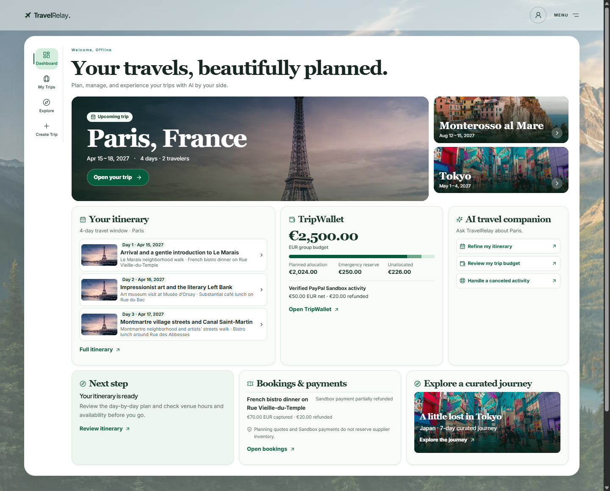

# TravelRelay

TravelRelay is an AI travel planner that brings an editable itinerary, a trip budget, and booking recovery into one workspace. It was built for the PayPal AI Hackathon.

[Open the hosted app](https://travelrelay.vercel.app) · [View the example trip without signing in](https://travelrelay.vercel.app/example-trip) · [See the public source](https://github.com/DarshP-Dev/TravelRelay)

## Try the hosted app

Explore one of six curated trips or sign up to plan and save a private trip. The [example trip](https://travelrelay.vercel.app/example-trip) uses labeled sample data and needs no account, AI request, or payment credentials. The verified production release is [`d3d99e3`](https://github.com/DarshP-Dev/TravelRelay/commit/d3d99e320c16d55c2195544f2491bc372150c513).

| Feature                         | What it does                                                                                                                                                                                                                                            |
| ------------------------------- | ------------------------------------------------------------------------------------------------------------------------------------------------------------------------------------------------------------------------------------------------------- |
| AI trip generation              | Builds a single-base itinerary from your dates, origin, interests, pace, and group budget. Background jobs save progress; the full itinerary appears only after server validation and persistence. Travel days, prices, and schedules may be estimates. |
| Itinerary and Bryntum Scheduler | Review days in a list or a visual schedule. Preview edits, including drag and resize, before saving. The server checks scheduling conflicts, travel buffers, and budget changes.                                                                        |
| Ask TravelRelay                 | Uses the saved trip to answer questions and propose edits. Review schedule and budget differences, then approve or reject; a proposal cannot apply itself or overwrite a newer itinerary.                                                               |
| TripWallet                      | Separates planned estimates, confirmed payments and refunds, the protected reserve, and remaining funds. Original currencies are preserved; FX conversions are indicative.                                                                              |
| Bookings and Recovery           | Shows booking and recovery state. The recovery workflow compares alternatives for a canceled experience and separates itinerary approval, refunds, and replacement checkout.                                                                            |
| Activity Insights               | Google Places is disabled in the hosted release. Named activities can offer a Google Maps search link without displaying fabricated ratings, reviews, or venue verification.                                                                            |

## PayPal Sandbox: verified locally

The public deployment shows the Bookings, TripWallet, and Recovery workspaces. Sandbox checkout and simulated cancellations are disabled on that deployment.

In a separate local QA environment, PayPal JavaScript SDK v6 handled buyer approval. Server-side PayPal Orders v2 and Payments v2 calls verified the original **USD 5.00 capture**, its **completed USD 5.00 refund**, and the **USD 5.00 replacement capture**. A simulated cancellation and a separately approved itinerary change linked the two distinct demo bookings in Recovery. TripWallet retained all three financial events in its append-only ledger, leaving USD 5.00 net Sandbox spending. See the [Sandbox setup guide](docs/paypal-sandbox.md), [recovery workflow](docs/trip-recovery.md), and [local acceptance evidence](docs/milestone-5-final-acceptance.md).

These were Sandbox transactions, with no real charges or supplier reservations. Signed PayPal webhook delivery was not verified end to end.

## Run locally

Use Node.js 24 and npm:

```sh
git clone https://github.com/DarshP-Dev/TravelRelay.git
cd TravelRelay
npm ci
npm run setup:local
npm run dev
```

Open [localhost:3000](http://localhost:3000). Setup creates an ignored `.env.local` if absent, generates a local auth secret, and applies the migrations to local PGlite. If you already have an environment file, check that it points to your intended local database before running setup. The labeled example works without provider keys.

- **AI:** Use `OPENAI_API_KEY` with the default `AI_PROVIDER=openai` and `OPENAI_MODEL=gpt-6.1-sol`. To select Gemini explicitly, set `AI_PROVIDER=gemini` and `GEMINI_API_KEY`; there is no automatic provider fallback. See the [AI provider guide](docs/ai-providers.md).
- **PayPal:** For a local Sandbox demo, set `PAYPAL_ENVIRONMENT=sandbox`, `ENABLE_DEMO_MERCHANT=true`, and the Sandbox client ID, client secret, and merchant ID as documented in the [Sandbox setup guide](docs/paypal-sandbox.md). The buyer signs in directly with PayPal using a separate Sandbox Personal account. The [recovery guide](docs/trip-recovery.md) covers the optional cancellation simulation.
- **Secrets:** [`.env.example`](.env.example) lists variable names and safe defaults. Put private values only in ignored local configuration or your host's server-side secret store. Leave `ACTIVITY_INSIGHTS_ENABLED=false` and `GOOGLE_PLACES_API_KEY` unset for the keyless experience.

## Architecture and screenshots

Next.js and React serve the workspace; Better Auth manages sessions; Drizzle persists owner-scoped records to PostgreSQL. Production runs on Vercel Fluid Compute and Neon using a restricted pooled database role. Local development uses PGlite by default. See the [architecture](docs/architecture.md), [financial model](docs/financial-architecture.md), and [deployment runbook](docs/deployment.md).

The screenshots below use offline test data. The displayed payment statuses and balances are simulated; the real Sandbox verification is documented above.



See the [Bryntum itinerary](docs/screenshots/hackathon-itinerary.png), [mobile activity details](docs/screenshots/hackathon-activity-mobile.png), and [image credits](docs/image-credits.md).

[Hackathon submission notes and demo checklist](docs/hackathon-submission.md) · [MIT License](LICENSE)
